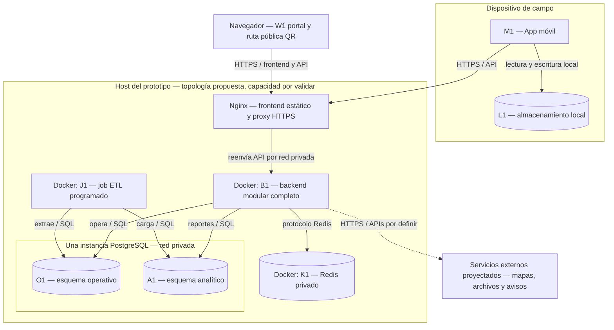

# Arquitectura Técnica y Despliegue

## 1. Arquitectura lógica y arquitectura física

La arquitectura lógica describe responsabilidades y comunicaciones: clientes, API REST, módulos, persistencia, caché y analítica. La arquitectura física describe dónde se ejecutan esos elementos: dispositivos cliente, contenedores Docker y recursos de servidor o nube.

No deben confundirse. Varios módulos lógicos pueden ejecutarse dentro de una misma aplicación backend y un mismo contenedor de aplicación.

## 2. Diagrama de despliegue propuesto

**Leyenda:** marcos = nodos o entorno físico; cajas = procesos/aplicaciones; cilindros = datos; flechas = conexiones iniciadas por el origen; discontinua = integración proyectada. Solo Nginx recibe tráfico público. Los siete módulos de negocio están dentro de B1, no en siete contenedores Docker.

**Persistencia:** PostgreSQL requiere volumen persistente y copias con restauración comprobada. L1 debe sobrevivir al reinicio del móvil. Redis contiene datos reconstruibles; perder la caché no debe perder el historial. O1 y A1 comparten recursos físicos: esta topología no ofrece alta disponibilidad ni aislamiento analítico. No se han medido capacidad ni disponibilidad.

## 3. Nodos propuestos

| Nodo                   | Responsabilidad                                       | Tecnología de referencia                      | Estado                                                                                                                                                                                    |
| ---------------------- | ----------------------------------------------------- | --------------------------------------------- | ----------------------------------------------------------------------------------------------------------------------------------------------------------------------------------------- |
| Cliente de campo       | Captura local y sincronización                        | Flutter + almacenamiento local                | Propuesto en la propuesta técnica                                                                                                                                                         |
| Cliente web            | Formularios del primer recorrido; QR sigue proyectado | React 19 / Vite 8                             | Implementado para S/P/H; ver ADR-009 y C4 actual.                                                                                                                                         |
| Servidor web           | Entregar archivos compilados y API del corte local    | Express 5; proxy TLS Nginx proyectado         | El corte sirve ambos desde B1. Nginx no forma parte de Compose actual.                                                                                                                    |
| Servidor de aplicación | API REST y S/P/H en una unidad desplegable            | Node 24 / Express 5 / JavaScript ESM          | Decisión aceptada para este corte en ADR-009. Los restantes módulos siguen proyectados.                                                                                                   |
| Persistencia OLTP      | Datos transaccionales, lotes e historial              | PostgreSQL                                    | Decisión documentada (ADR-004)                                                                                                                                                            |
| Caché                  | Respuestas frecuentes QR                              | Redis                                         | Componente previsto en la arquitectura objetivo (ADR-005); se debe probar la política de expiración y el beneficio de rendimiento. Si se decide excluirlo del MVP, se actualizará la ADR. |
| Proceso ETL            | Transformar/extraer datos para analítica              | Job programado; tecnología por decidir        | Propuesto                                                                                                                                                                                 |
| Datamart               | Indicadores analíticos                                | Esquema lógico analítico PostgreSQL al inicio | Propuesto                                                                                                                                                                                 |
| Contenedores           | Repetibilidad del despliegue                          | Docker                                        | Restricción RC05 / ADR-007                                                                                                                                                                |
| Servicios externos     | Mapas, archivos y notificaciones                      | Proveedor por seleccionar                     | Integraciones proyectadas                                                                                                                                                                 |

## 4. Topología para el prototipo

La propuesta original incluye dimensionamientos académicos de referencia para servidor web, aplicación, base de datos/analítica y dispositivo móvil. Son valores de planificación, no una garantía de capacidad ni una recomendación para producción. El dimensionamiento real debe validarse mediante pruebas de carga, retención de datos, copias de seguridad y presupuesto.

Para reducir complejidad en el prototipo:

- Puede iniciarse con una aplicación backend en un contenedor Docker.
- PostgreSQL conserva el almacén transaccional principal.
- El Datamart puede empezar como esquema lógico separado en PostgreSQL, alimentado por ETL. En la misma instancia comparte recursos con OLTP; su impacto se validará mediante EQ-07.
- Redis se conserva como componente previsto para consultas QR, con validación de su necesidad y política de expiración.
- Los archivos adjuntos deben almacenarse fuera de las tablas transaccionales cuando el volumen y la operación lo justifiquen.
- Los servicios externos solo se integran cuando estén dentro del alcance aprobado.

## 5. Seguridad de la red y del despliegue

- Exponer únicamente endpoints necesarios y protegerlos mediante HTTPS.
- La base de datos y Redis no deben quedar expuestos directamente a internet.
- Guardar credenciales en variables de entorno o gestor de secretos; nunca en Git.
- Configurar copias de seguridad y probar la restauración.
- Separar permisos de base de datos por responsabilidad cuando la tecnología y el tiempo lo permitan.
- Registrar errores operativos y acciones críticas evitando capturar secretos o datos sensibles en logs.

## 6. Stack de la arquitectura objetivo: referencia histórica

Para evitar mantener alternativas indefinidamente, se recomienda evaluar y aprobar un stack coherente:

- Web: React + TypeScript + Tailwind.
- Móvil: Flutter.
- Backend: NestJS + TypeScript.
- Datos: PostgreSQL.
- Caché: Redis incluido en la arquitectura objetivo (ADR-005), con beneficio y políticas pendientes de validación. Su exclusión del MVP requerirá actualizar la ADR y los diagramas.
- Analítica: proceso ETL y Datamart lógico sobre PostgreSQL en la primera iteración.
- Despliegue: Docker y servidor Cloud académico.

NestJS fue una recomendación de la arquitectura objetivo. La decisión técnica actual para el primer recorrido es Node 24 + Express 5 + JavaScript ESM, React/Vite y PostgreSQL 18, aceptada en [ADR-009](07-decisiones-primer-recorrido.md). La [vista C4 implementada](../04-modelo-c4/modelo-c4.md) documenta los procesos y componentes existentes. Una migración futura requeriría otro ADR.

## Alcance ejecutable del primer recorrido — 2026-11-11

El subconjunto implementado y la selección Express/React están precisados en [ADR-009/010](07-decisiones-primer-recorrido.md). Las vistas anteriores conservan la arquitectura objetivo, incluyendo componentes todavía proyectados.
