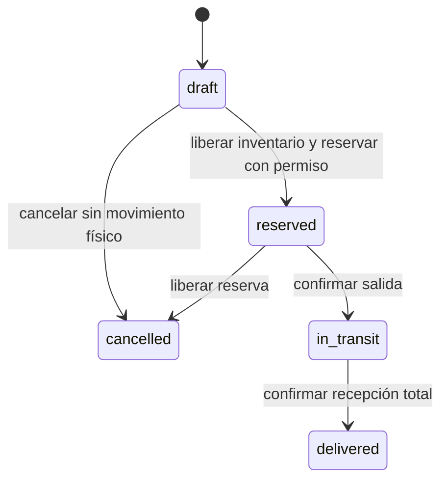

# Propuesta: Inventario, Despacho y Entrega

2026-11-16. **Pendiente de decisiones D1–D9. No implementada ni aprobada como regla de negocio.** Base: main d7da0d691937e607e8258f37650b47fe7fd6af22, merge técnico del PR #5 conservando commits. [Revisión QR/Redis](../05-sprint01/revision-pr5.md). No supone aprobación docente ni validación agrícola.

## 1. Objetivo y alcance inicial recomendado

Recorrido interno para un lote consolidado, un centro de origen y un destino de entrega: admitir el total documentado en cuarentena, liberarlo explícitamente para logística si Calidad está cerrada/accepted, preparar transporte, reservar, despachar el lote completo y confirmar entrega total. El estado de publicación QR no interviene. El escenario completo de este documento es **condicional a elegir todas las opciones A de D1–D9**; ninguna se adopta por silencio.

Primer incremento sin despacho parcial, división/mezcla de lotes, empaque/pallets, traslados entre centros, devoluciones, pérdidas, liquidaciones, integración SUNAT/GPS, firma externa ni procesamiento offline. RF-10 queda parcial respecto de empaque. Las otras opciones se describen para decidir el alcance, no se ejecutan como supuestas reglas.

Mapa propuesto de capacidades, dentro del componente Logística e Inventario del monolito, no microservicios nuevos:

| ID estable | Responsabilidad | Depende de |
| --- | --- | --- |
| inventory | Admisión, cuarentena/liberación, saldo y movimientos exactos | Acceso; fuente inmutable de Trazabilidad; elegibilidad mínima de Calidad |
| shipment | Preparación, reserva, salida y cancelación previa a salida | inventory; Acceso |
| delivery | Confirmación de la entrega del despacho | shipment; mismo registro de movimientos y transacción |

Orden candidato de implementación tras decidir: admisión/consulta → liberación → reserva/cancelación → despacho → entrega. No se implementa este orden ahora.

## 2. Restricciones acordadas, independientes de D1–D9

1. Calidad y QR no autorizan despacho por sí solos. Una evaluación `closed/accepted` es requisito necesario, no suficiente. Se necesita liberación logística explícita, reserva, permisos y comando de salida.
2. Pendiente, draft, observed y rejected no pueden reservar para salida ni despacharse en el alcance recomendado. Se revalida elegibilidad al liberar, reservar y despachar; no basta un estado guardado en UI.
3. Descarte de muestra no descuenta inventario: 3 frutos examinados y 1 descartado siguen sin justificar reducir un lote de 1000.000 kg.
4. No inventar pérdidas, conversiones ni movimientos pasados. Sin relleno/seed de inventario histórico. Admitir hoy un lote ya existente requeriría evidencia física actual y registra el hecho de hoy; nunca reconstruye una entrada pretérita.
5. Kg exactos con hasta tres decimales, como los netos/aportes existentes, sin floats/redondeo implícito, exponente, cajas→kg ni kg→pallets. Las sumas se conservan en todas las transacciones.
6. Lote, recepciones, aportes, origen, temperaturas y eventos cerrados permanecen intactos. Los nuevos movimientos referencian la identidad/composición existente; no vuelven a crear masa.
7. Guía, vehículo, placa, chofer, precinto, destino interno y evidencia de entrega no se incorporan al DTO público QR ni se copian automáticamente a descripciones públicas. ADR-008/013 permanecen vigentes.

## 3. Decisiones que debe responder el usuario

Todos los ejemplos son ficticios. El lote ejemplo L contiene R1=600.000 kg y R2=400.000 kg, total 1000.000 kg, con composición/origen conservados.

| ID | Opción A — recomendada para empezar | Opción B / C | Ejemplo y motivo |
| --- | --- | --- | --- |
| D1 Ingreso y estados | Admisión **explícita del total** por responsable del centro, con evidencia actual; entra en cuarentena. Identidad única por lote/centro. | B: ingreso automático solo para nuevas consolidaciones desde activación, en la misma transacción. Nunca backfill automático. | L ingresa hoy con 1000.000 kg. Un segundo ingreso es conflicto. Si se encuentran 980.000 kg, se bloquea la admisión: los 20.000 kg de diferencia no se inventan como merma. A permite verificar el hecho físico antes de reconocer stock. |
| D2 Calidad e inventario | Liberación logística explícita y auditada tras `closed/accepted`; sin cambio de kg. Revalidar en reserva/salida. | B: exigir además otra persona para liberar respecto de quien cerró Calidad; mantiene liberación explícita. | Calidad accepted deja 1000.000 kg en cuarentena hasta liberar. Observed/rejected/pending tienen 0 kg despachables. La muestra no altera los 1000.000 kg. A reduce separación de funciones inicial sin eliminar permisos. |
| D3 Completo o parcial | Un lote completo por despacho; no fraccionar ni mezclar. Cantidad derivada por servidor, no editable. | B: parcial con kg y asignación explícita a aportes/unidades físicas, pendiente de diseñar y verificar antes de implementarlo. | A: reservar/despachar 1000.000 kg, nunca 600.000. B: 600.000 + 400.000 restantes; no asumir FIFO ni qué recepción aportó esos 600.000 sin evidencia de separación física. |
| D4 Reserva | Reserva explícita antes de salida, sin caducidad automática; cancelación explícita libera la reserva. | B: reserva con expiración, por ejemplo 15 min; requiere reloj/worker y serializar expiración frente a salida. | Reservar 1000.000 deja 0.000 disponibles. Otra reserva de 1000.000 falla. Cancelar antes de salir restituye disponibilidad de 1000.000, sin crear otra entrada física. A evita movimientos automáticos por tiempo. |
| D5 Empaque y pallets | Excluir ambos del primer recorrido. Despacho por lote; estado empacado aún no cubierto. | B: incorporar empaque y pallets de un solo lote, con asignaciones medidas y composición explícita. C: pallets multilote/mezclas, diferir a otro incremento. | Si B: pallets de 600.000 y 400.000 suman 1000.000, no otros 1000.000 de stock adicional. El número de cajas no determina kg. QR por pallet sigue fuera del alcance QR acordado. A evita introducir simultáneamente fraccionamiento y doble conteo. |
| D6 Transporte | Guía manual de referencia única por centro, identificación de vehículo, placa, nombre del chofer y precinto obligatorios antes de reservar/salir; destino interno obligatorio. No reutilizar referencia de guía en otro despacho, incluso cancelado. | B: precinto no usado permitido solo con indicador explícito y motivo; decidir también política de reutilización de guía. | `DEMO-GR-001`, unidad ficticia, `DEMO-001`, chofer ficticio, `DEMO-P001`. No capturar DNI/teléfono sin necesidad. No se afirma validez fiscal/legal ni emisión de documentos oficiales. A tiene un contrato completo y comprobable. |
| D7 Entrega | Solo confirmación total, registrada por usuario autorizado del centro de origen con fecha y evidencia de recepción. La salida ya descontó el stock en centro. | B: entregas parciales/incidencias; exige definir remanente en tránsito, devoluciones y conciliación física, sin pérdidas automáticas. | A: salida H=0/T=1000; entrega T=0/E=1000. Si se reportan 980.000, no se confirma entrega total ni se inventa pérdida de 20.000: siguen 1000.000 en tránsito hasta un procedimiento explícito. B admitiría E=980/T=20 solo con esa regla aprobada. |
| D8 Cancelación y corrección | Cancelar solo draft/reserved. Corregir datos de transporte antes de salida con versión, motivo y evento que conserva el valor anterior. Después de salida/entrega, sin edición ordinaria ni cancelación retroactiva. | B: reversas/devoluciones y rectificaciones posteriores como hechos adicionales autorizados; diseñar primero sus efectos físicos/documentales. | Cancelar una reserva de 1000.000 libera 1000.000 sin sumarlos otra vez a H. Tras salida no se restituyen 1000.000 por pulsar cancelar; un retorno futuro requiere evidencia real. A mantiene un límite verificable. |
| D9 Permisos | Concesiones por acción/organización/centro. Una misma persona puede tener las acciones necesarias; sin herencia de admin, Calidad o publicación. | B: separación de personas para liberar, despachar y/o confirmar entrega; especificar pares incompatibles. | Norte no puede reservar los 1000.000 kg de Sur. Una cuenta con quality:close o publication:publish tiene 0 autorizaciones logísticas implícitas. A facilita una demo pequeña conservando control por operación. |

Formato de respuesta sugerido: `D1=A, D2=A, …, D9=A`, indicando cambios concretos. Elegir B/C obliga a actualizar contratos, estados, migraciones y casos afectados antes de escribir código. No se requiere elegir A para continuar la conversación.

## 4. Estados y transiciones propuestos bajo las opciones recomendadas

Se separan tres dimensiones para no confundir calidad, preparación logística y ubicación de masa:

| Modelo | Estados / significado |
| --- | --- |
| Calidad, existente | Sin evaluación/draft/closed y accepted/observed/rejected. Sigue perteneciendo a Q; Logística no lo modifica. |
| Disposición de inventario, propuesta | `quarantine`: admitido pero no habilitado para salida; `released`: liberado explícitamente para logística con evidencia de Calidad accepted. Liberado no significa despachado. |
| Despacho, propuesto | `draft`: transporte preparado, sin reserva; `reserved`: masa retenida en centro; `in_transit`: salida física confirmada; `delivered`: recepción total confirmada; `cancelled`: cerrado antes de salida. |
| Empaque | D5=A: `not_managed`, sin afirmar que el lote esté empacado. D5=B requiere otro modelo/transición y aprobación previa. |

RF-10 «aprobado» se mostraría como **liberado para logística**, separado del resultado accepted. «Despachado» corresponde a in_transit y luego delivered. «Empacado» queda pendiente con D5=A. No se reescribe el estado histórico `pending_quality` registrado al consolidar.

Transiciones permitidas: sin entrada → quarantine; quarantine → released si Calidad cerrada/accepted; draft → reserved si liberado/elegible y stock suficiente; reserved → in_transit; in_transit → delivered total; draft/reserved → cancelled. No hay vuelta de in_transit a stock ni reapertura de delivered/cancelled. Una corrección de transporte previa a salida conserva estado y kg, avanza versión y registra evento.

El diagrama es propuesta de despacho; no implementa transiciones en el código actual.

## 5. Conservación de cantidades

Por entrada: A=kg admitidos, H=kg físicamente en centro, R=kg reservados (subconjunto de H), U=H−R libres, T=kg en tránsito, E=kg entregados. Invariantes: **A = H + T + E**, 0≤R≤H, U≥0; todos exactos. Kg despachables = U solo si disposición released y Calidad closed/accepted; en otro caso 0. No sumar R a H porque lo duplicaría.

Son cantidades del registro de movimientos: «en tránsito» significa despachado y aún no confirmado íntegramente como entregado, no una ubicación medida por GPS. Si se reporta diferencia, mantener el saldo pendiente no afirma que se haya localizado esa diferencia; evita fabricar un ajuste hasta definir la conciliación.

| Hecho | A | H | R | U | T | E | Despachable |
| --- | ---: | ---: | ---: | ---: | ---: | ---: | ---: |
| Admitir en cuarentena | 1000 | 1000 | 0 | 1000 | 0 | 0 | 0 |
| Cerrar Calidad accepted | 1000 | 1000 | 0 | 1000 | 0 | 0 | 0 |
| Liberar explícitamente | 1000 | 1000 | 0 | 1000 | 0 | 0 | 1000 |
| Reservar | 1000 | 1000 | 1000 | 0 | 0 | 0 | 0 |
| Cancelar antes de salida (rama alternativa) | 1000 | 1000 | 0 | 1000 | 0 | 0 | 1000 |
| Salir desde reserved | 1000 | 0 | 0 | 0 | 1000 | 0 | 0 |
| Confirmar entrega total | 1000 | 0 | 0 | 0 | 0 | 1000 | 0 |

Las filas de salida/entrega continúan la reserva, no la fila alternativa de cancelación. La entrega **no vuelve a restar H**. Los movimientos son hechos nuevos positivos con tipo explícito: admitted (+H), reserved (+R), reservation_released (−R), dispatched (−H/−R/+T), delivered (−T/+E). No se aceptan deltas arbitrarios ni cantidades negativas del cliente. Liberación/corrección de transporte son eventos sin movimiento de kg.

R1/R2 y origen siguen referenciados por L en toda salida completa. Empaque, si se aprueba luego, solo asigna masa ya existente: sumar lote y pallets como existencias independientes está prohibido. Sin reportar merma, conversión o rendimiento productivo a partir del descarte de muestra.

## 6. Concurrencia, idempotencia y fallos

PostgreSQL es autoridad de stock; no usar Redis para decidir reserva/salida. Orden único propuesto de bloqueos para todos los comandos: revalidar sesión/concesiones → clave idempotente del actor → entradas de inventario ordenadas por UUID → despachos ordenados por UUID. Comprobar versión, estado, elegibilidad y saldo **después** del bloqueo. Unicidad de admisión por lote, una reserva/salida activa completa por entrada y una entrega por despacho respaldan las reglas en DB.

Dos reservas de 1000.000 sobre H=1000.000 no pueden ambas confirmar. Cancelación frente a salida, corrección frente a salida y dos entregas se serializan; un ganador y conflicto del perdedor. Versión de despacho y versión de inventario separadas en cada comando que modifica ambas. Consultas de balances/historia usan un snapshot consistente y paginan a 100, sin mezclar estados de transacciones distintas.

Idempotency-Key UUID por intención. Hash de operación/recurso/cuerpo normalizado; misma clave/cuerpo devuelve respuesta original, distinto cuerpo/operación = 409. Revalidar permisos antes del replay. Se conserva la clave mientras sea posible el reintento; no añadir TTL arbitrario. Actualización de versiones, movimiento, evento, evidencia interna, auditoría y respuesta idempotente comparten unitOfWork: fallo en cualquiera revierte todo. Después de respuesta perdida no se crea otra intención a ciegas.

## 7. Contratos internos y HTTP propuestos — no registrados todavía

Acceso mediante sesión/CSRF/origen existentes. Body estricto, sin actor, organización, estados, saldos o resultado de Calidad enviados como autoridad. Instantes ISO con zona, no futuros; recepción de entrega ≥ salida. Cantidades como cadenas normalizadas a tres decimales, kg exclusivamente. UUID normalizados como en Acopio/Calidad; referencias documentales no se reinterpretan como documentos oficiales.

| Método /api/v1 | Entrada candidata | Salida / regla |
| --- | --- | --- |
| GET /inventory?centerId=…&offset=… | Centro autorizado, offset acotado | items, limit=100; sin centro autorizado 403 |
| POST /inventory/entries | `{lotId,verifiedKg,reference,evidenceRef}` | 201: entrada quarantine por total derivado desde T1; verifiedKg debe coincidir exactamente; UNIQUE lote, sin redefinir masa del lote |
| GET /inventory/entries/:id | ID interno | StockEntry y resumen mínimo de elegibilidad; enlace a movimientos |
| GET /inventory/entries/:id/movements?offset=… | ID/offset | Movimientos privados, limit=100 y snapshotVersion; balance de esa respuesta en la misma transacción |
| POST /inventory/entries/:id/release | `{expectedVersion,reason}` | 201: released; registra evaluación/versión utilizadas por servidor; H sin cambios |
| GET /shipments?centerId=…&offset=… | Centro autorizado | Página de 100 con estados internos |
| POST /shipments | `{stockEntryId,transport,destinationLabel}` | 201: draft; cantidad completa derivada; no reserva implícita |
| GET /shipments/:id | ID interno | Shipment y enlaces de historia, solo ámbito autorizado |
| PUT /shipments/:id/transport | `{expectedVersion,transport,reason}` | 200: corrección antes de salida, evento con antes/después; sin variar kg |
| POST /shipments/:id/reservation | `{expectedVersion,expectedInventoryVersion}` | 201: reserved; bloquea entrada y despacho, exige U=total |
| POST /shipments/:id/departure | `{expectedVersion,expectedInventoryVersion,departedAt}` | 201: in_transit; reserva propia, Calidad y transporte revalidados |
| POST /shipments/:id/delivery | `{expectedVersion,expectedInventoryVersion,receivedKg,deliveredAt,evidenceRef}` | 201: delivered; receivedKg debe coincidir con quantityKg; no doble descuento |
| POST /shipments/:id/cancellation | `{expectedVersion,expectedInventoryVersion,reason}` | 201: cancelled solo antes de salida; libera R si corresponde |
| GET /shipments/:id/events?offset=… | ID/offset | Historia privada paginada, sin edición/borrado |

Todos los comandos requieren Idempotency-Key; replay autorizado = 200 sin otro movimiento. 400 clave inválida; 401 sesión; 403 lista/CSRF/origen; 404 recurso ajeno; 409 versión/estado/duplicado/stock insuficiente (`STOCK_INSUFFICIENT`); 422 entrada, parcial no admitido o elegibilidad inválida; 413 payload excesivo; 500 error seguro y rollback; 503 dependencia no disponible sin confirmar. Mantener sobre de error actual, sin SQL ni datos privados. No se propone endpoint DELETE, «aprobar lote» genérico ni asignación libre de estados.

DTO StockEntry: `{id,lotId,centerId,disposition,version,admittedKg,onHandKg,reservedKg,unreservedKg,inTransitKg,deliveredKg,dispatchableKg,unit:'kg',qualitySummary,packagingState}`. qualitySummary expone solo evaluación/versión/estado/resultado necesarios a logística, no captura, notas ni datos personales. packagingState=not_managed bajo D5=A.

DTO Shipment: `{id,stockEntryId,lotId,centerId,quantityKg,unit:'kg',state,version,transport,destinationLabel,departedAt,delivery,createdAt,updatedAt}`; datos de actor/evidencia solo para permisos internos e historia. transport=`{guideReference,vehicleLabel,plate,driverName,sealReference}` bajo D6=A, con límites de texto y representación escapada. No DNI/teléfono por defecto. Delivery contiene receivedKg, fecha, evidencia y usuario interno que registró la confirmación; no supone firma/confirmación electrónica del receptor externo.

Contratos por puerto: T1.inventorySource(tx,scope,lotId) devuelve centro, total exacto e identidad/composición inmutables; Q.eligibility(tx,scope,lotId) devuelve solo evaluación/versión/state/result; S.requireCenter/audit reutiliza permisos transaccionales. Implementaciones de repositorios no se importan entre módulos. El permiso logístico habilitaría este resumen mínimo, no quality:read completo. Mantener la misma conexión tx para movimientos/auditoría. DTO público QR actual **sin cambios**.

## 8. Pantallas propuestas

- Inventario por centro: lotes aún no admitidos, admisión con evidencia actual, saldo H/R/U/T/E, Calidad y disposición separadas; botón de liberar solo con concesión y resumen accepted. Ausencias muestran «no registrado», no cero inventado de hechos pasados.
- Preparar despacho: elegir un lote completo del centro, cantidad/origen solo lectura, datos internos de transporte/destino, guardar draft. Mostrar que guardar no reserva ni despacha.
- Revisar y reservar: 1000.000 kg propuestos, disponibilidad actual, referencias de origen y versiones. Conflicto obliga a consultar saldo vigente; no ajustar cantidad automáticamente.
- Salida: reserva propia, lote/Calidad/liberación y transporte completos, confirmación explícita. Mensaje de éxito solo tras commit. Después de salida, transporte/masa cerrados para edición ordinaria.
- Entrega: solo despachos in_transit; cantidad esperada visible, recibido/instante/evidencia internos. Discrepancia impide confirmar bajo D7=A; no se propone un botón que fabrique merma o retorno.
- Historia/corrección/cancelación: eventos privados paginados; motivo obligatorio y efectos de cancelar visibles. Carga/vacío/error/éxito, sin permiso, conflicto y respuesta perdida con reintento de misma intención. Teclado, foco y diseño móvil siguiendo los componentes actuales.

## 9. Migraciones propuestas, sin archivos SQL ejecutables

Nombres tentativos 006_inventory y 007_shipments; numeración a revalidar al implementar. No se modifican 001–005 ni se insertan movimientos para lotes históricos.

La migración futura ampliaría el CHECK de acciones de access.center_grants con los permisos logísticos elegidos, sin concederlos automáticamente a roles o usuarios existentes. Los movimientos referenciarían la intención/recurso que generó cada efecto, con unicidad que impida repetirlo. No se crea esa ampliación ahora.

| Almacén propuesto | Integridad requerida |
| --- | --- |
| inventory.entries | UUID, lot/org/center con FK compuesta, total admitido exacto positivo, disposición y versión; UNIQUE lotId. Actor/fecha del servidor, referencia/evidencia actual y vínculo de liberación a evaluación/versión. |
| inventory.movements | Hechos append-only con entryId, shipmentId cuando aplique, tipo, kg exactos positivos, actor/org/center, recordedAt y occurredAt; unicidad de efecto por comando/recurso. FKs compuestas de ámbito, sin UPDATE/DELETE/TRUNCATE. |
| logistics.shipments | UUID, entry/lot/org/center, quantityKg, estado, versión, transporte privado/destino y marcas de tiempo. Restricción de una reserva/salida completa activa por entrada y referencia de guía única según D6. |
| logistics.deliveries | UNIQUE shipmentId; recibido exacto total bajo D7=A, evidencia y fechas/actor; inmutable. No nuevo ingreso de stock en destino. |
| logistics.events / requests | Snapshots privados antes/después, secuencia/versión, claves por actor y hash/respuesta. Auditoría en access.audit, misma transacción; historia/claves inmutables. |

Fuente de cantidades: movimientos, con lectura derivada bajo bloqueo/snapshot consistente y versión en entrada como serialización. Si posteriormente se proponen contadores persistidos, tendrán que contrastarse contra movimientos; no se aceptan dos fuentes independientes de stock. CHECK/FK/UNIQUE/índices y triggers deben respaldar estados/inmutabilidad; invariantes agregadas se validan bajo bloqueo transaccional, no con un CHECK que intente consultar otras filas.

Down solo en base desechable y en orden inverso; un rollback productivo del código no borra movimientos. Respaldo/recuperación antes de despliegue futuro. Fixtures nuevos, sin backfill ni alteración de hechos de Acopio/Calidad/QR.

## 10. Permisos y auditoría candidatos

Concesiones `inventory:read`, `inventory:admit`, `inventory:release`, `shipment:read`, `shipment:create`, `shipment:update`, `shipment:reserve`, `shipment:dispatch`, `shipment:deliver`, `shipment:cancel` por usuario/org/centro. No permisos por texto del rol admin ni por publication:publish/quality:close. Revalidar sesión activa y concesión dentro de transacción antes del replay. Otra organización/centro no ve recursos ni cambia stock. D9=B añadiría separación explícita de personas y sus pruebas.

Auditar cada admisión, liberación, cambio de transporte, reserva, cancelación, salida y entrega con actor/centro/instante/recurso/versión/motivo y resultado conforme al patrón existente. Movimiento, historial, clave y audit exitoso atómicos. Los datos privados no van a logs genéricos, Redis público, QR ni futuros reportes públicos. Un fallo no se registra como movimiento exitoso.

## 11. Criterios de aceptación y pruebas que deberán implementarse tras decidir

| ID | Caso exigido bajo recomendaciones |
| --- | --- |
| ID-01 | Admitir lote consolidado autorizado de 1000.000: quarantine y H=1000.000; evidencia y auditoría. Pre-lote/recepción como lotId: rechazo. |
| ID-02 | Misma entrada no puede admitirse dos veces, incluso con claves distintas o concurrentes. No movimientos creados por migración/seed para históricos. |
| ID-03 | Total viene del origen inmutable; recibir 980.000 donde T1 dice 1000.000 bloquea, sin inventar merma. |
| ID-04 | Pending/draft/observed/rejected no liberan, reservan ni salen; accepted sin liberación tampoco. QR publicado no modifica elegibilidad. |
| ID-05 | Liberar con concesión y accepted conserva 1000.000; muestra con 33.33% de descarte no resta kg. |
| ID-06 | Cajas, exponentes, NaN, negativos, precisión extra, deltas o estados/actor arbitrarios rechazados sin cambios. |
| ID-07 | Guardar draft no reserva. Reserva total de 1000.000: H=1000/R=1000/U=0; intento parcial rechazado bajo D3=A. |
| ID-08 | Dos reservas/salidas concurrentes: un ganador, no stock negativo ni doble movimiento; clave igual reintentada produce un solo efecto. |
| ID-09 | Stock insuficiente aun con versión actual: 409 STOCK_INSUFFICIENT; estado/versión desactualizados: conflicto, sin ajustar cantidades automáticamente. |
| ID-10 | Salida exige reserva propia, permisos, Calidad/liberación y transporte completos; los comprueba de nuevo al confirmar. |
| ID-11 | Salida total: H=0/R=0/T=1000; composición R1=600/R2=400 y origen intactos. |
| ID-12 | Cancelar draft no crea masa; cancelar reserved deja H=1000/R=0; cancelación frente a salida tiene un solo desenlace válido. |
| ID-13 | Cancelar in_transit/delivered, reapertura o DELETE de hechos: denegados. Sin devolución ni reposición ficticia. |
| ID-14 | Corrección de transporte antes de salida conserva kg y antes/después; versión vieja o corrección frente a salida: conflicto. |
| ID-15 | Entrega total pasa T=1000→0 y E=0→1000 sin volver a descontar H; dos entregas concurrentes no duplican efecto. |
| ID-16 | Entrega 980.000, futura, previa a salida o sin evidencia: rechazada bajo D7=A, T sigue 1000.000; no se crean 20.000 de pérdida/retorno. |
| ID-17 | Sin sesión, acción específica o centro/org ajenos: denegados. Revocación/inactivación antes de replay también deniega, aunque la clave ya exista. |
| ID-18 | Misma clave con otro cuerpo/operación/recurso: 409. Respuesta perdida desde UI reintenta intención original sin otro movimiento. |
| ID-19 | Inyectar fallo real en movimiento, evento, audit y requests en cada comando: rollback completo de estado/versiones/kg/clave. |
| ID-20 | DB CHECK/FK/UNIQUE y triggers rechazan ámbitos inconsistentes, borrado/edición/truncate de hechos, duplicados y estados imposibles. |
| ID-21 | En cada prefijo de la historia, A=H+T+E, 0≤R≤H, U=H−R; tras reinicio sin seed se conservan todos los hechos y balances. |
| ID-22 | DTO público QR idéntico antes/después de transporte; sin guía, placa, chofer, precinto, destino privado ni evidencia de entrega en API pública/caché/QR. |
| ID-23 | Listas/historias internas paginadas y por centro, lectura consistente concurrente, sin campos de otros ámbitos. |
| ID-24 | E2E completo admitir→Calidad accepted existente→liberar→preparar→reservar→salir→entregar; casos de reserva perdida/cancelación y permisos ajenos, móvil/teclado. |

Unitarias: cantidades exactas, estados, elegibilidad e invariantes. Integración: PostgreSQL real, barreras de concurrencia, fallo real y persistencia; no solo repositorios simulados. E2E: Chromium aislado y UI contra servidor/DB dedicados. Mutar al menos guard de elegibilidad, doble despacho e invariante para demostrar sensibilidad, restaurar después. No omitir pruebas ni modificar gates para lograr verde. Si se elige B/C se deben añadir los casos de parciales, expiración, pallets, reversas o segregación antes de implementar esas opciones.

Fixture positivo futuro: recepciones de 600.000 y 400.000 kg con sus temperaturas originales registradas junto con cada recepción, como exige Calidad actualmente. Después se consolida L y se completa/cierra la evaluación manual ficticia. Si una original falta, Calidad no puede cerrarse y el stock no se libera; nunca completar el histórico informalmente para que la demo pase.

## 12. Trazabilidad, estructura y verificación documental

| Referencia | Cobertura propuesta / límite |
| --- | --- |
| RF-10 / HU06 | ID-01–16/21: stock, cuarentena, liberación, reserva, salida/entrega; parcial sin empacado con D5=A. Aún no implementado. |
| RF-11 / HU06 | ID-10/14/22: guía, vehículo, placa, chofer y precinto privados; no emisión/validación fiscal, GPS ni operación de transporte físico verificada. |
| Entrega — alcance conceptual y solicitud de 2026-11-16 | ID-15/16/24: confirmación total; el catálogo RF-01–13 no tiene RF propio de entrega. Formalizar ese requisito con el usuario/docente, sin inventar RF oficial. |
| RF-04/RF-05/RF-09 | ID-02/03/11/19–21: identidad, masa oficial, composición, hechos inmutables y auditoría. |
| RF-06/RF-07 | ID-04/05/10: resultado manual existente como requisito, no autorización automática ni regla agrícola nueva. |
| RF-08 / ADR-008/013 | ID-22: DTO público sin cambios, sin datos personales de transporte. |
| RF-13 / DA06 / EQ-04/05 | ID-17–20/23: permisos por centro, replay, integridad. Sin administración productiva de usuarios implícita. |
| RF-12 / ADR-006 | Movimientos darían fuentes futuras para indicadores; no se implementan ETL/reportes ni se inventan pérdidas. |

Ubicación candidata: `server/modules/logistics/`, adaptador HTTP propio, UI `web/logistics/`, pruebas en carpetas actuales; monolito modular y unitOfWork existentes. Ejemplo de estilo contractual: `quantityKg: "1000.000"`, estado derivado por servidor, SQL parametrizado y DTO estricto; Prettier y node:test/Playwright actuales. No se crean ahora esos archivos ni migraciones.

Comprobación actual de documentación: `node ../repo-qr/scripts/check.js` desde este worktree, que valida OpenAPI **implementado**, imports y enlaces; `git diff --check`. Al implementar tras aprobación: `npm.cmd ci --ignore-scripts`, `npm.cmd run format:check`, `npm.cmd run check`, `npm.cmd test`, `npm.cmd run test:integration`, `npm.cmd run test:redis`, `npm.cmd run build`, `npm.cmd run test:e2e`, en bases desechables independientes. En Unix usar npm. La integración incluye down/up y nunca debe apuntar a demo u operación real.

Siempre conservar cantidades/origen y pruebas; pedir decisión para D1–D9 antes de codificar; nunca aprobar opciones por defecto, rellenar historia, borrar evidencia ni declarar mejora de rendimiento sin medición. [ADR-014 propuesta](../02-arquitectura/11-decisiones-inventario-despacho.md), [continuidad](../05-sprint01/continuidad-inventario.md), [matriz de trabajo final](../05-sprint01/matriz-trabajo-final.md).
