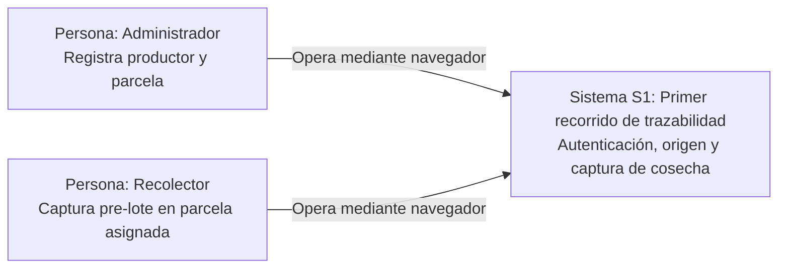
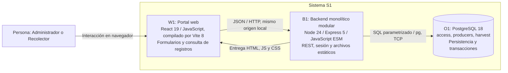
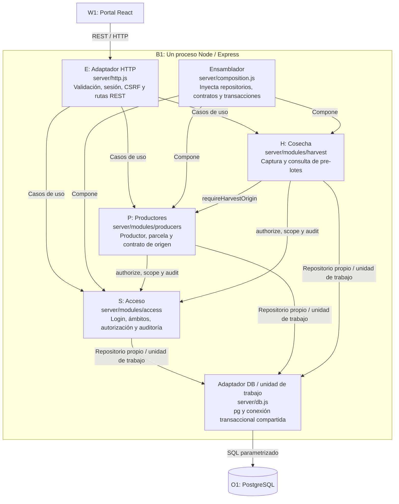
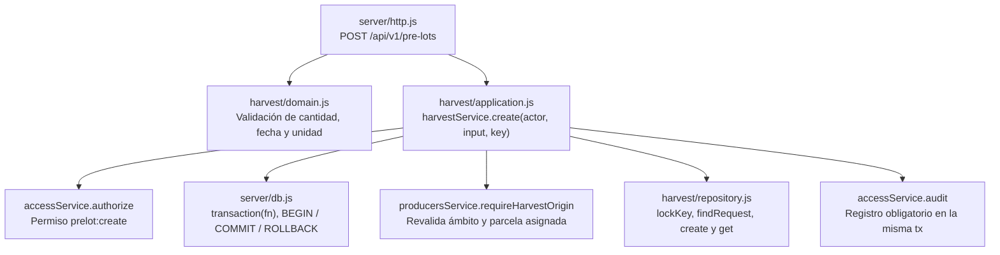

# Modelo C4 — Primer recorrido implementado

Revisión 2026-11-12. Estas vistas representan el código existente: Acceso, Productores y Cosecha/pre-lotes, con Express 5, React/Vite y PostgreSQL 18. [ADR-009/010](../02-arquitectura/07-decisiones-primer-recorrido.md) registra las decisiones. La [arquitectura objetivo](modelo-c4-objetivo.md) conserva las vistas anteriores de offline, QR, Redis, ETL y demás módulos propuestos; no se presentan como implementados.

Los identificadores S1/W1/B1/O1/S/P/H mantienen continuidad con el diseño objetivo. Contenedor C4 significa aplicación o almacén lógico; no equivale a una imagen Docker. El portal W1 se ejecuta en el navegador y sus archivos compilados se sirven desde B1.

## 1. Alcance y evidencia

El administrador registra productores y parcelas ficticios. El recolector consulta sus parcelas asignadas y registra una cosecha/pre-lote; organización, rol y asignación limitan las operaciones. El rol lector inicia sesión pero no tiene operaciones habilitadas en este corte. No hay administración UI de usuarios/asignaciones, captura offline, consolidación de lotes, QR público, acopio/calidad, logística, analítica ni liquidaciones.

Los diagramas describen implementación, no certifican por sí solos un despliegue. [Evidencia local, Compose y CI](../05-sprint01/cierre-primer-recorrido.md) registra qué se ejecutó realmente.

## 2. C1 — Contexto del sistema S1

El productor es una entidad registrada por el administrador; este corte no implementa una cuenta de productor independiente. No hay sistemas externos ejecutables en este recorrido.

## 3. C2 — Contenedores de S1

Docker Compose ejecuta `app` (B1 y archivos de W1) y `db` (O1). No hay servidor Vite de desarrollo en ese despliegue. El puerto publicado es `APP_PORT` —3000 por defecto, 3002 en la sesión de revisión— y la DB permanece en red privada. El override E2E publica opcionalmente DB en loopback 55433, distinto del PostgreSQL nativo 55432. El volumen `pgdata` conserva datos al recrear contenedores.

HTTP está limitado a la demostración local; el modo de producción exige un origen HTTPS y proxy TLS. Las [instrucciones de arranque](../../tecnologia/primer-recorrido.md) no equivalen a una configuración productiva completa.

## 4. C3 — Componentes del backend B1

Cada módulo contiene `domain.js`, `application.js` y `repository.js`. Los casos de uso reciben objetos con contratos desde el ensamblador; no importan el repositorio de otro módulo. Dominio no depende de Express ni de pg. `server/http.js` es un adaptador compartido, no un módulo de negocio adicional. Los repositorios de S/P/H usan la misma conexión `tx` cuando participan en una captura.

## 5. C4 — Código del registro de pre-lote

Esta vista amplía H mediante funciones y archivos JavaScript reales, sin inventar clases de un framework. Es una relación de llamadas/contratos, no un diagrama de procesos independientes.

La clave de idempotencia UUID está acotada al actor, con bloqueo transaccional y restricción UNIQUE. La repetición idéntica recupera el resultado; un payload diferente devuelve 409. Si falla la auditoría, se revierte cosecha y pre-lote. La migración `001` y las pruebas de integración contienen la evidencia ejecutable de estas reglas.

## 6. Continuidad y límites

| Identificador | Elemento implementado                 | Fuente                                          |
| ------------- | ------------------------------------- | ----------------------------------------------- |
| S1            | Primer recorrido en línea             | `server/main.js`, `web/main.jsx`                |
| W1            | Portal React, un único origen con API | `web/`, `vite.config.js`, `server/http.js`      |
| B1            | Monolito modular Express              | `server/composition.js`, `server/modules/`      |
| S/P/H         | Acceso, Productores y Cosecha         | Casos de uso y repositorios de cada módulo      |
| O1            | PostgreSQL 18                         | `migrations/001_initial.up.sql`, `compose.yaml` |

La [vista objetivo](modelo-c4-objetivo.md) conserva los siete módulos y los modelos QR/offline como evolución propuesta. Express es la decisión de backend del corte actual; NestJS permanece únicamente como alternativa histórica de evolución y requeriría un nuevo ADR para adoptarse. No se crean módulos nuevos para completar los diagramas.
