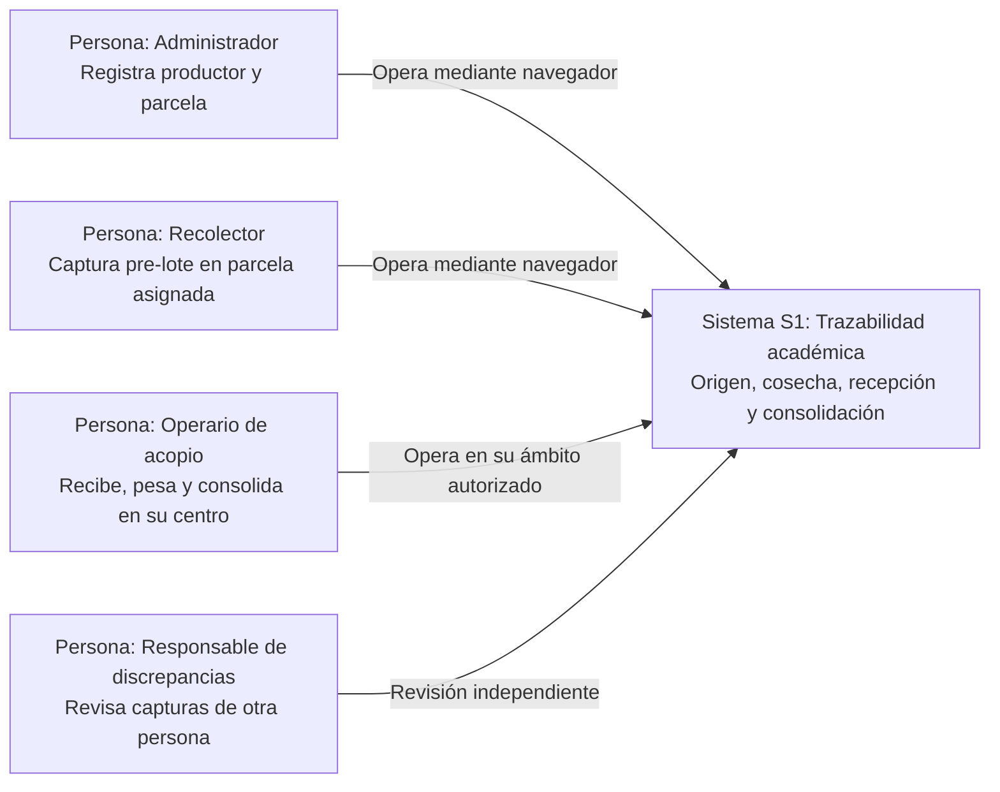
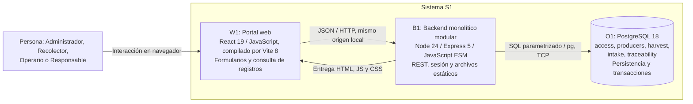
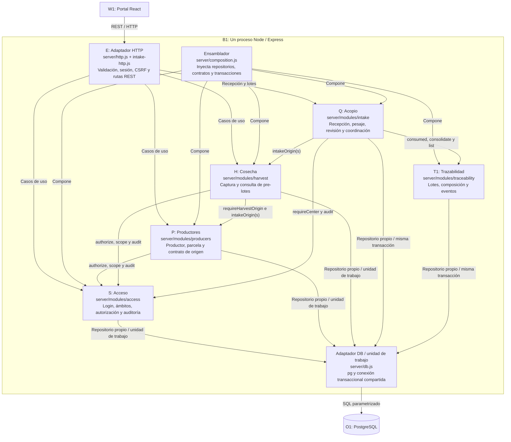
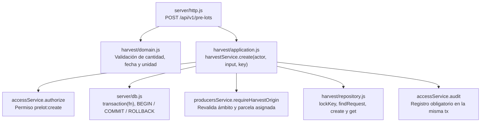
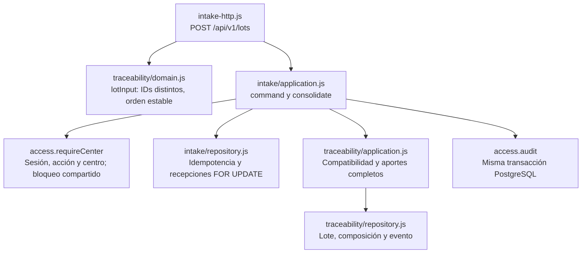

# Modelo C4 — Primer recorrido y Acopio académico

Revisión 2026-11-14. Estas vistas representan Acceso, Productores, Cosecha/pre-lotes, Acopio y consolidación en Trazabilidad, con Express 5, React/Vite y PostgreSQL 18. Acopio responde a D1–D7 adoptadas por el usuario solo para prototipo académico: sin validación agrícola ni aprobación docente. [ADR-009/010](../02-arquitectura/07-decisiones-primer-recorrido.md) registra las decisiones. La [arquitectura objetivo](modelo-c4-objetivo.md) conserva las vistas anteriores de offline, QR, Redis, ETL y demás módulos propuestos; no se presentan como implementados.

Los identificadores S1/W1/B1/O1/S/P/H/Q/T1 mantienen continuidad con el diseño objetivo. Contenedor C4 significa aplicación o almacén lógico; no equivale a una imagen Docker. El portal W1 se ejecuta en el navegador y sus archivos compilados se sirven desde B1.

## 1. Alcance y evidencia

El administrador registra productores y parcelas ficticios. El recolector consulta sus parcelas asignadas y registra una cosecha/pre-lote; organización, rol y asignación limitan las operaciones. Una cuenta sin concesiones no tiene operaciones de Acopio. El operario recibe/pesa/confirma/consolida solo en centros con concesión por acción; otra persona autorizada revisa las discrepancias. El lote queda pendiente de calidad y sin despacho. No hay administración UI de usuarios/asignaciones, captura offline, QR público, aprobación de calidad, logística, analítica ni liquidaciones. [Decisiones de Acopio](../02-arquitectura/08-decisiones-acopio.md).

Los diagramas describen implementación, no certifican por sí solos un despliegue. [Evidencia local, Compose y CI](../05-sprint01/cierre-primer-recorrido.md) registra qué se ejecutó realmente.

## 2. C1 — Contexto del sistema S1

El productor es una entidad registrada por el administrador; este corte no implementa una cuenta de productor independiente. No hay sistemas externos ejecutables en este recorrido.

## 3. C2 — Contenedores de S1

Docker Compose ejecuta `app` (B1 y archivos de W1) y `db` (O1). No hay servidor Vite de desarrollo en ese despliegue. El puerto publicado es `APP_PORT` —3000 por defecto, 3002 en la sesión de revisión— y la DB permanece en red privada. El override E2E publica opcionalmente DB en loopback 55433, distinto del PostgreSQL nativo 55432. El volumen `pgdata` conserva datos al recrear contenedores.

HTTP está limitado a la demostración local; el modo de producción exige un origen HTTPS y proxy TLS. Las [instrucciones de arranque](../../tecnologia/primer-recorrido.md) no equivalen a una configuración productiva completa.

## 4. C3 — Componentes del backend B1

Cada módulo contiene `domain.js`, `application.js` y `repository.js`. Los casos de uso reciben objetos con contratos desde el ensamblador; no importan el repositorio de otro módulo. Dominio no depende de Express ni de pg. `server/http.js` es un adaptador compartido, no un módulo de negocio adicional. Los repositorios de S/P/H/Q/T1 propagan la misma conexión `tx`. Q coordina la consolidación; T1 no llama de vuelta a Q. Las FK y los triggers entre esquemas respaldan la integridad en el motor compartido, sin imports de repositorios ajenos en código.

## 5. C4 — Código del registro de pre-lote

Esta vista amplía H mediante funciones y archivos JavaScript reales, sin inventar clases de un framework. Es una relación de llamadas/contratos, no un diagrama de procesos independientes.

La clave de idempotencia UUID está acotada al actor, con bloqueo transaccional y restricción UNIQUE. La repetición idéntica recupera el resultado; un payload diferente devuelve 409. Si falla la auditoría, se revierte cosecha y pre-lote. La migración `001` y las pruebas de integración contienen la evidencia ejecutable de estas reglas.

## 6. C4 — Código de la consolidación en Q/T1

Esta vista amplía Q y T1 del C3. Las flechas representan llamadas/contratos en un proceso y una transacción, sin servicios separados.

La revisión de discrepancias conserva medición y declaración; otra persona autorizada aprueba antes de la confirmación. H = neto confirmado, S = H − aportes. Recepciones se bloquean ordenadas y cada una tiene un aporte único: no parcialidades ni doble consumo. Lote, aportes, evento, auditoría y resultado idempotente se confirman juntos o se revierten. El total se deriva de aportes con numeric exacto. Triggers impiden cambiar, borrar o truncar hechos/eventos y agregar composición a un lote cerrado. Calidad permanece pendiente y no existe permiso/ruta de despacho.

## 7. Continuidad y límites

| Identificador | Elemento implementado                                | Fuente                                                               |
| ------------- | ---------------------------------------------------- | -------------------------------------------------------------------- |
| S1            | Primer recorrido y Acopio académico                  | `server/main.js`, `web/main.jsx`                                     |
| W1            | Portal React, un único origen con API                | `web/`, `vite.config.js`, `server/http.js`                           |
| B1            | Monolito modular Express                             | `server/composition.js`, `server/modules/`                           |
| S/P/H/Q/T1    | Acceso, Productores, Cosecha, Acopio y consolidación | Casos de uso y repositorios de cada módulo                           |
| O1            | PostgreSQL 18                                        | `migrations/001_initial.up.sql`, `002_intake.up.sql`, `compose.yaml` |

La [vista objetivo](modelo-c4-objetivo.md) conserva los siete módulos y los modelos QR/offline como evolución propuesta. Express es la decisión de backend del corte actual; NestJS permanece únicamente como alternativa histórica de evolución y requeriría un nuevo ADR para adoptarse. Q y la consolidación de T1 corresponden al código y a la especificación académica; calidad, QR y las demás capacidades objetivo siguen fuera del corte.
